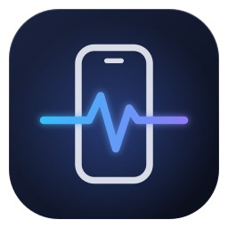

  

<h1 align="center">iLogic Diagnostic</h1>

  Diagnosi iPhone, analisi panic log, certificati di collaudo e archivio tecnico per laboratori di riparazione. 
  <b>by iLogicLab</b>

  <a href="https://github.com/ilogiclab/ilogic-diagnostic-updates/releases/latest"><b>⬇ Scarica l'ultima versione</b></a>

---

## Indice

1. [Requisiti](#requisiti)
2. [Installazione](#installazione)
3. [Primo accesso e attivazione della licenza](#primo-accesso-e-attivazione-della-licenza)
4. [Diagnosi di un iPhone](#diagnosi-di-un-iphone)
5. [Panic log](#panic-log)
6. [Appunti](#appunti)
7. [Video guide](#video-guide)
8. [Raccolta ufficiale iLogicLab](#raccolta-ufficiale-ilogiclab)
9. [Storico](#storico)
10. [Impostazioni](#impostazioni)
11. [Licenza: scadenza e rinnovo](#licenza-scadenza-e-rinnovo)
12. [Aggiornamenti](#aggiornamenti)
13. [Problemi comuni](#problemi-comuni)
14. [Assistenza](#assistenza)

---

## Requisiti

- PC con **Windows 10 o 11** (64 bit).
- **Driver Apple**: installa **iTunes** oppure l'app **Dispositivi Apple** dal Microsoft Store. Senza driver l'iPhone non viene visto.
- Un **cavo dati** Lightning o USB-C (meglio originale).
- Utente, password e chiave di licenza ricevuti da iLogicLab.

## Installazione

1. Apri la pagina [Releases](https://github.com/ilogiclab/ilogic-diagnostic-updates/releases/latest) e, sotto **Assets**, scarica il file `iLogic_Diagnostic_Setup_vX.Y.Z.exe`.
2. Apri il file scaricato e segui l'installazione.
3. Se Windows mostra **"Windows ha protetto il PC"**: clicca **Ulteriori informazioni** → **Esegui comunque**.

> **Errore 4551 – "Un criterio di controllo dell'applicazione ha bloccato il file"**
> È **Smart App Control** di Windows 11. Per installare il programma:
> **Impostazioni → Privacy e sicurezza → Sicurezza di Windows → Controllo app e browser → Impostazioni di Smart App Control → Disattivato**, poi riapri l'installer.
> Su alcune versioni di Windows, una volta disattivato, Smart App Control non si può riattivare senza reinstallare Windows. Antivirus e SmartScreen restano comunque attivi.

## Primo accesso e attivazione della licenza

1. Apri **iLogic Diagnostic** e premi **Attiva licenza**.
2. Inserisci **utente**, **password** e **chiave di licenza** che hai ricevuto. La chiave inizia con `ILD-`: copiala tutta, trattini compresi.
3. Premi **Attiva e accedi**.

Dalle volte successive basta inserire utente e password.

**Codice PC.** In basso nella schermata di accesso trovi il **Codice di questo PC** (pulsante *Copia*). Se iLogicLab te lo chiede, mandalo prima di ricevere la chiave: la licenza funzionerà solo su quel computer.

## Diagnosi di un iPhone

1. Collega l'iPhone con il cavo, **sbloccalo** e premi **Rileva iPhone**.
2. Se sul telefono compare *"Vuoi autorizzare questo computer?"*, tocca **Autorizza**, inserisci il codice e premi di nuovo **Rileva iPhone**.
3. Il programma mostra:
   - **Dispositivo** – modello, iOS, capacità, numero di serie, IMEI. Clicca un valore per copiarlo.
   - **Batteria** – salute stimata, cicli di carica, temperatura, matricola.
   - **Panic log** – riavvii anomali registrati dall'iPhone, causa più probabile e verifiche consigliate.
   - **Archivio** – quanti appunti e video hai per quel modello.
4. Compila **Cliente e aspetto** (cliente, grado estetico, note, tecnico).
5. Compila il **Collaudo funzionale**: per ogni voce **OK**, **KO** o **N.T.** (non testato).
6. Premi **Genera certificato** per il PDF di collaudo (viene salvato nello Storico) oppure **Stampa etichetta** per l'etichetta 60×40 mm.

Premi **Nuova** per passare al dispositivo successivo.

## Panic log

La pagina **Panic log** mostra in dettaglio i riavvii anomali dell'ultimo iPhone letto:

- a sinistra l'elenco dei panic con la data;
- a destra l'**ipotesi principale**, dove guardare, le verifiche in ordine e il testo completo del panic.

Con **Apri file .ips…** puoi analizzare anche panic log ricevuti dal cliente o esportati dall'iPhone (*Impostazioni → Privacy e sicurezza → Analisi e miglioramenti → Dati di analisi*).
Le indicazioni sono ipotesi di partenza: verifica sempre sullo schema del modello.

## Appunti

Il tuo archivio di casi particolari e procedure.

- **Nuovo appunto** – titolo, modello (anche più di uno, separati da virgola), tag, problema e soluzione.
- **Foto** – *+ Aggiungi foto…* per scegliere i file, oppure copia un'immagine (screenshot con `Win`+`Maiusc`+`S`) e premi **Incolla foto**. Ricordati di premere **Salva appunto**.
- **Ricerca** – la casella in alto cerca in titolo, modello, tag e testo.
- **PDF** – *Esporta PDF* crea il PDF dell'appunto aperto; *Esporta elenco in PDF* mette in un unico file tutti gli appunti che stai vedendo.

## Video guide

Raccogli i link ai tutorial (YouTube, TikTok, Instagram, Facebook…).

- **Aggiungi video** → incolla il link. Per YouTube, TikTok e Vimeo titolo e miniatura si compilano da soli.
- **▶ Guarda** apre il video in una piccola finestra che resta sopra le altre, così lo segui mentre lavori.

## Raccolta ufficiale iLogicLab

Con la licenza ricevi gratuitamente la **raccolta ufficiale iLogicLab**: appunti e video tecnici selezionati, aggiornati periodicamente.

- La trovi in **Appunti** e **Video guide** con l'etichetta **iLogicLab**. Usa i filtri **Tutti / Miei / iLogicLab**.
- Si aggiorna da sola quando apri il programma, oppure con **Aggiorna raccolta**.
- È in sola lettura: con **Copia nei miei appunti** ne fai una copia tua da modificare.

## Storico

Tutti i certificati emessi su questo PC, con ricerca per cliente, modello, numero di serie o IMEI.
Da ogni riga puoi riaprire il **PDF**, ristampare l'**Etichetta** o **Eliminare** il collaudo. **Esporta Excel (CSV)** crea un file con tutti i collaudi.

## Impostazioni

- **Dati aziendali** – nome, contatti e indirizzo della **tua** attività, stampati su certificati e PDF.
- **Collaudo** – tecnico predefinito.
- **Cartella certificati ed etichette** – dove salvare i PDF (anche una cartella di rete).
- **Aspetto** – tema scuro, chiaro o come Windows.
- **Archivio tecnico** – cartella di appunti e video: scegli una cartella di rete condivisa per averli uguali su più PC del tuo laboratorio.

## Licenza: scadenza e rinnovo

- La durata parte dal giorno in cui attivi la chiave. La data di scadenza è in basso a sinistra; negli ultimi 14 giorni compare un avviso.
- Alla scadenza il programma si blocca e chiede una nuova chiave. I tuoi dati (storico, appunti, video) **non vengono persi**.
- Per rinnovare chiedi una nuova chiave a iLogicLab e inseriscila nella schermata di blocco, oppure prima della scadenza con **Rinnova licenza** (in basso a sinistra).
- La chiave va attivata entro 30 giorni da quando la ricevi.
- Non spostare indietro la data del PC: il programma se ne accorge e si blocca.

## Aggiornamenti

All'apertura il programma controlla se c'è una nuova versione. Se c'è, premi **Aggiorna ora** e conferma la richiesta di Windows: il programma si aggiorna e si riapre da solo. Dati e impostazioni restano.
Puoi controllare anche da **Impostazioni → Controlla aggiornamenti**.

## Problemi comuni

| Problema | Soluzione |
|---|---|
| "Nessun iPhone trovato" | Usa un cavo dati, sblocca l'iPhone e verifica che sia installato iTunes o Dispositivi Apple. |
| Chiede di toccare "Autorizza" | Tocca **Autorizza** sull'iPhone, inserisci il codice e premi di nuovo **Rileva iPhone**. |
| Errore 4551 all'installazione | Disattiva Smart App Control (vedi [Installazione](#installazione)). |
| "Chiave di licenza non valida" | Copia la chiave tutta, da `ILD-` all'ultimo carattere, senza spazi aggiunti. |
| "Questa chiave è legata a un altro PC" | La chiave è per un altro computer: manda a iLogicLab il **Codice di questo PC**. |
| "Chiave scaduta prima dell'attivazione" | Sono passati più di 30 giorni: chiedi una nuova chiave. |
| Salute batteria "N/D" | Alcuni modelli o versioni di iOS non forniscono il dato via USB. |
| Il programma non si apre | Manda a iLogicLab il file `errore_avvio.txt` che trovi in `%LOCALAPPDATA%\iLogicLab\iLogic Diagnostic`. |

## Assistenza

**iLogicLab** · ilogiclab.it@gmail.com · [www.ilogicshop.com](https://www.ilogicshop.com)

iLogic Diagnostic utilizza componenti di terze parti, tra cui libimobiledevice (LGPL 2.1). L'elenco completo è nel file TERZE_PARTI.txt, nella cartella di installazione.
